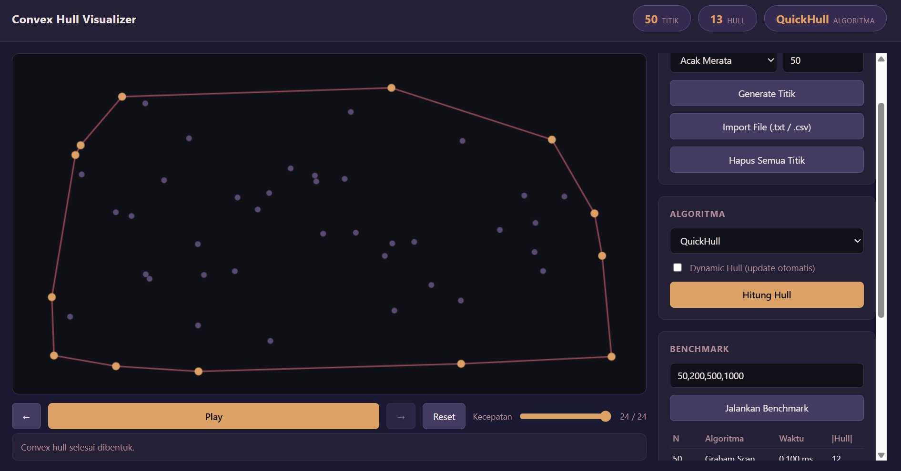
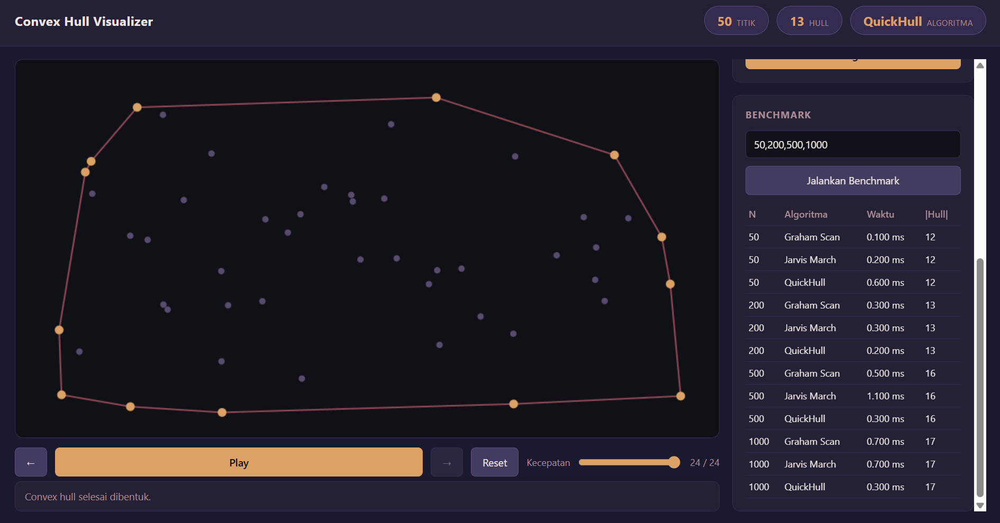

# Convex Hull Visualizer

## Deskripsi Program

Convex Hull Visualizer adalah program untuk menghitung dan memvisualisasikan proses pembentukan convex hull dari sekumpulan titik dua dimensi. Pengguna dapat memasukkan titik secara manual melalui klik pada canvas, membangkitkan titik secara acak dengan beberapa pola distribusi, atau mengimpor dataset dari file. Program menyediakan tiga algoritma convex hull yang diimplementasikan dari nol (Graham Scan, Jarvis March, dan QuickHull) beserta visualisasi langkah demi langkah dari setiap algoritma sehingga proses pembentukan hull dapat diamati untuk setiap langkahnya.

## Fitur Program

**Input dataset**
- Menambahkan titik dengan klik pada canvas, termasuk mode hapus titik dengan klik pada titik terdekat.
- Generate titik acak dengan lima pola yakni acak merata, lingkaran, tepi persegi panjang, distribusi Gaussian, dan cluster.
- Impor dataset dari file `.txt` atau `.csv` dengan format satu titik per baris (`x,y` atau `x y`).

**Visualisasi**
- Seluruh titik ditampilkan pada canvas dengan warna yang berbeda dari titik-titik yang menjadi bagian dari convex hull.
- Canvas menyesuaikan ukuran jendela dan langsung menggambar ulang setiap kali dataset berubah.

**Algoritma**
- Graham Scan, Jarvis March, dan QuickHull diimplementasikan sendiri tanpa memanggil fungsi convex hull dari library manapun.
- Pengguna bisa berpindah algoritma dan membandingkan hasilnya pada dataset yang sama.

**Visualisasi step by step**
- Setiap algoritma merekam setiap langkahnya (pemilihan pivot, pengurutan sudut polar, push/pop stack pada Graham Scan, pemilihan titik awal dan pencarian titik berikutnya pada Jarvis March, dan pembagian rekursif pada QuickHull).
- Kontrol Play, Pause, Next, Previous, dan Reset, dengan slider kecepatan animasi.

**Dynamic convex hull**
- Bila mode "Dynamic Hull" diaktifkan, hull dihitung ulang secara otomatis setiap kali titik ditambah atau dihapus, tanpa perlu menekan tombol hitung ulang.

**Benchmark algoritma**
- Menjalankan Graham Scan, Jarvis March, dan QuickHull pada beberapa ukuran dataset sekaligus, menampilkan jumlah titik, waktu eksekusi, dan jumlah titik hull yang dihasilkan.

**Penanganan kasus khusus**
- Dataset kosong, satu titik, dan dua titik ditangani tanpa program crash.
- Titik duplikat dihapus otomatis sebelum diproses.
- Titik kolinear tidak ikut menjadi vertex hull kecuali titik ujung dari garis tersebut.

## Teknologi dan Framework

Program dibangun dengan HTML, CSS, dan JavaScript murni tanpa framework maupun library convex hull eksternal. Rendering visual memakai Canvas API bawaan browser. Karena tidak ada proses build, program cukup dibuka lewat browser modern atau server statis sederhana.

## Penjelasan Convex Hull

Convex hull dari sekumpulan titik adalah poligon cembung terkecil yang memuat seluruh titik tersebut. Jika seluruh titik dianggap sebagai paku yang ditancapkan pada papan, convex hull adalah bentuk yang dihasilkan ketika sebuah karet gelang dilepaskan mengelilingi paku-paku tersebut. Semua titik yang tidak berada pada batas karet gelang berada di dalam poligon, sedangkan titik pada batasnya menjadi vertex dari hull.

## Penjelasan Graham Scan

Graham Scan bekerja dengan memilih satu titik acuan (pivot), yaitu titik dengan koordinat paling ekstrem (di program ini dipilih titik paling bawah pada layar), lalu mengurutkan seluruh titik lain berdasarkan sudut polar terhadap pivot tersebut. Setelah terurut, algoritma menelusuri titik satu per satu sambil menjaga sebuah stack. Untuk setiap titik baru, algoritma memeriksa apakah tiga titik teratas pada stack membentuk belokan ke arah yang konsisten (convex). Jika tidak, titik teratas stack dikeluarkan (pop) hingga belokan kembali convex, baru kemudian titik baru dimasukkan (push). Hasil akhir stack adalah convex hull.

## Penjelasan Jarvis March

Jarvis March bekerja mulai dari titik paling kiri sebagai titik pasti anggota hull. Dari titik tersebut, algoritma mencari titik lain sedemikian sehingga seluruh titik pada dataset berada di satu sisi garis yang menghubungkan titik saat ini dengan kandidat tersebut. Titik itulah yang dipilih sebagai titik hull berikutnya. Proses ini diulang dari titik baru tadi hingga penelusuran kembali ke titik awal, sehingga membentuk poligon convex hull secara utuh.

## Penjelasan QuickHull

QuickHull memakai strategi divide and conquer. Dua titik dengan koordinat x minimum dan maksimum diambil sebagai garis pemisah awal. Titik-titik dibagi ke sisi kiri dan kanan garis tersebut, lalu pada tiap sisi dicari titik terjauh dari garis sebagai vertex hull baru. Titik terjauh tersebut membentuk dua garis baru, dan proses dicari secara rekursif pada dua subhimpunan titik yang berada di luar garis-garis baru itu, hingga tidak ada lagi titik yang tersisa di luar.

## Analisis Kompleksitas Algoritma

| Algoritma | Waktu (rata-rata) | Waktu (kasus terburuk) | Ruang |
|---|---|---|---|
| Graham Scan | O(n log n) | O(n log n) | O(n) |
| Jarvis March | O(n h) | O(n^2) | O(n) |
| QuickHull | O(n log n) | O(n^2) | O(n) |

Keterangan: n adalah jumlah titik input, h adalah jumlah titik pada convex hull.

Graham Scan didominasi oleh proses pengurutan berdasarkan sudut polar, sehingga kompleksitasnya konsisten di O(n log n) untuk semua kasus. Jarvis March lebih efisien saat jumlah titik pada hull (h) kecil dibanding n karena kompleksitasnya bergantung langsung pada h, tetapi memburuk menjadi O(n^2) ketika hampir semua titik berada pada hull. QuickHull rata-rata seefisien Graham Scan, namun pada kasus terburuk seperti seluruh titik berada pada satu lingkaran, pembagian rekursifnya menjadi tidak seimbang dan kompleksitasnya turun ke O(n^2).

Dari sisi ruang, ketiga algoritma menyimpan titik input dan hasil hull dalam struktur berukuran linear terhadap n, sehingga sama-sama O(n).

## Screenshot Hasil Program

Input titik acak pada canvas:


Hasil convex hull dengan Graham Scan:


Visualisasi step by step saat algoritma sedang berjalan:


Hasil convex hull dengan Jarvis March:


Hasil convex hull dengan QuickHull:



Panel benchmark yang membandingkan waktu eksekusi ketiga algoritma:



## Cara Menjalankan Program

Program tidak memerlukan instalasi dependency maupun proses build.

1. Clone atau unduh repository ini.
2. Buka folder proyek, lalu jalankan server statis sederhana, misalnya:
   ```
   python3 -m http.server 8000
   ```
3. Buka browser dan akses `http://localhost:8000`.

Alternatif lain, `index.html` juga bisa dibuka langsung lewat browser (double click), namun sebagian browser membatasi ES Modules yang dibuka lewat `file://`, sehingga menjalankan lewat server statis lebih disarankan.

Dataset contoh untuk fitur import tersedia di `data/contoh-input.csv`.

## Referensi

- Cormen, T. H., Leiserson, C. E., Rivest, R. L., & Stein, C. (2009). *Introduction to Algorithms* (3rd ed.). MIT Press.
- de Berg, M., Cheong, O., van Kreveld, M., & Overmars, M. (2008). *Computational Geometry: Algorithms and Applications* (3rd ed.). Springer.
- Barber, C. B., Dobkin, D. P., & Huhdanpaa, H. (1996). The Quickhull Algorithm for Convex Hulls. *ACM Transactions on Mathematical Software*.

## Video Demonstrasi

`https://drive.google.com/file/d/1juShaQuzwyjqbs0Ubwf5Z6fZNY2juGm8/view?usp=sharing`
